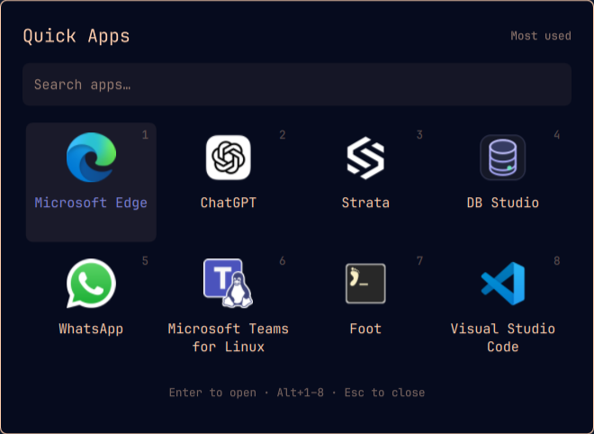

# Quick Apps for Omarchy

Your eight most-used apps, one shortcut away.  Built to keep it as simple as possible to launch your most used apps.

Quick Apps learns which applications you use and puts them in a compact grid
with four columns and two rows. Type to search all installed apps, then open an
app or switch to its existing window.



- Learns from app switches across your desktop, including launches from other menus and shortcuts.
- Opens existing windows across workspaces and restores minimized windows on Omarchy 4.5.
- Searches beyond the first eight apps using Omarchy's app search.
- Supports arrows, Enter, mouse selection, and Alt+1–8.
- Follows your Omarchy theme, fonts, scale, and active monitor.
- Keeps usage history on your computer. No accounts, telemetry, or network requests.
- English and Spanish; other languages fall back to English.

## Requirements and compatibility

Quick Apps is an Omarchy **4.x shell plugin**, intended for **4.0.6 and newer**.
It uses the Quickshell, Hyprland Lua dispatchers, and application library shipped
with Omarchy; no additional runtime packages or build step are required.

| Environment | Validation |
| --- | --- |
| Omarchy 4.5.0rc1-1 | Live desktop verification and isolated QML integration tests |
| Omarchy 4.0.6 shell components | Isolated QML integration tests using the installed Quickshell/Hyprland runtime |
| Complete Omarchy 4.0.6 desktop | Not yet verified; see [compatibility notes](docs/COMPATIBILITY.md) |
| Omarchy 3.x | Unsupported |

The plugin supplies its own overlay instead of requiring 4.5's dock or app grid.
On 4.5 it follows Setup → Language live; on 4.0.x it uses the session locale.

## Install

```sh
omarchy plugin add https://github.com/Andean-Bridge/omarchy-quick-apps.git --enable
```

The plugin runs inside the existing Omarchy shell. There is no install hook,
background daemon, privileged command, or second desktop shell.

## Set up your shortcut

**Recommended: Super + R.** Super is the Windows/Command key on most keyboards.
Press **Super + K** to view your existing bindings and check for a conflict.

Open `~/.config/hypr/bindings.lua` and add this line:

```lua
o.bind("SUPER + R", "Quick Apps", "omarchy-shell shell toggle andean-bridge.quick-apps '{}'")
```

Reload and check the configuration, then press **Super + R** to open Quick Apps:

```sh
hyprctl reload
hyprctl configerrors
```

Installation does **not** change your shortcuts or replace Super+Space. Choose
any unused combination. To replace an existing binding on 4.0.x, explicitly
unbind it with `hl.unbind(...)` before adding the replacement; 4.5 also provides
`o.rebind(...)`.

Open it without a shortcut:

```sh
omarchy-shell shell summon andean-bridge.quick-apps '{}'
```

## Use

| Input | Action |
| --- | --- |
| Type | Search all visible installed apps; shows up to eight matches |
| Arrow keys / Tab / Shift+Tab | Move selection |
| Enter | Open or focus the selected app |
| Alt+1–8 | Open or focus that numbered slot |
| Click | Open or focus an app |
| Escape | Clear a search, then close the menu |
| Click outside / shortcut again | Close the menu |

The order stays fixed while you are choosing an app. A fresh installation has
no earlier usage history: running apps appear first, followed by the remaining
apps alphabetically. The list adapts as you use your desktop. On narrow screens,
the menu uses fewer columns and scrolls when needed.

Apps without windows, such as another shell panel, still launch normally;
focusing depends on matching a visible window to its desktop entry.

## Configure

Configuration lives outside the git-managed plugin so updates preserve it:

```text
${XDG_CONFIG_HOME:-~/.config}/omarchy/quick-apps.json
```

The file is optional and reloads when saved. Start from
[examples/quick-apps.json](examples/quick-apps.json). For example:

```json
{
  "version": 1,
  "starterApps": ["microsoft-edge", "chatgpt", "foot"],
  "hiddenApps": ["foot-server"],
  "appAliases": { "Chatgpt": "chatgpt" },
  "learning": true,
  "focusDelayMs": 1800,
  "cooldownSeconds": 60,
  "halfLifeDays": 14
}
```

| Setting | Default | Meaning |
| --- | --- | --- |
| `starterApps` | `[]` | Preferred apps before enough history exists; these are not pinned above learned favorites |
| `hiddenApps` | `[]` | Desktop IDs to exclude from this menu and its learning |
| `appAliases` | `{}` | Exact window class → desktop ID mappings, matched without case sensitivity |
| `learning` | `true` | Record new usage; turning this off retains the existing ranking |
| `focusDelayMs` | `1800` | App must stay focused this long to count; 500–30,000 ms |
| `cooldownSeconds` | `60` | Minimum interval between counts for one app; 10–3,600 seconds |
| `halfLifeDays` | `14` | Days until an old score loses half its weight; 1–365 days |

Desktop IDs are the `.desktop` filenames without the suffix. Find app window
classes with `hyprctl -j clients`; launcher files live in
`~/.local/share/applications` and `/usr/share/applications`. For Chromium/Edge
web apps whose class differs from their desktop entry, add an exact alias using
those actual values. Personal profiles are intentionally not hardcoded.

## Learning and privacy

An app earns one count after it remains focused for the configured delay, or
when you choose it from Quick Apps. The cooldown avoids counting the launch
and resulting focus twice. Scores decay gradually so the list can follow
changes in your routine. This measures usage frequency, not total time spent.

The plugin stores only desktop IDs, aggregate scores, and last-count timestamps:

```text
${XDG_STATE_HOME:-~/.local/state}/omarchy/quick-apps/history.json
```

It does not store window titles, document contents, keystrokes, search queries,
or browsing history. There is no network code. History is bounded to 1,000 app
records and written atomically inside an owner-only directory (mode `0700`).
Native Omarchy hidden-app filters also apply.

To reset learning, disable the plugin, delete only that history file, and enable
it again. Disabling first prevents the in-memory history from being saved again.

## Update, disable, or remove

```sh
omarchy plugin update andean-bridge.quick-apps
omarchy plugin disable andean-bridge.quick-apps
omarchy plugin remove andean-bridge.quick-apps
```

Remove your Quick Apps line from `~/.config/hypr/bindings.lua` when uninstalling.
Configuration and learned history are retained outside the plugin directory;
delete the two files above separately if you want to erase them. Removing this
plugin leaves Omarchy's regular menu and application launchers in place.

## Troubleshooting

```sh
omarchy-shell shell rescanPlugins
omarchy plugin enable andean-bridge.quick-apps
omarchy-shell shell call andean-bridge.quick-apps status ''
```

If the source changed but the shell still runs cached code, run
`omarchy restart shell`. If an app opens a second window, confirm its window
class and add an `appAliases` entry. History write failures appear in the status
response and the shell logs. Check QML failures with:

```sh
qs log -p "$OMARCHY_PATH/shell" --tail 100
```

## Development and publishing

Node.js 20+ and Python 3 are development tools only; there are no npm dependencies.

```sh
npm test
npm run check
omarchy plugin validate .
scripts/smoke.sh "$OMARCHY_PATH/shell"
```

The smoke test uses a disposable loader, stub launch actions, and temporary
config/history directories. It neither starts another desktop shell nor types
into applications. It requires an existing Wayland session and Quickshell.

See [CONTRIBUTING.md](CONTRIBUTING.md), the
[compatibility matrix](docs/COMPATIBILITY.md), and the
[publishing guide](docs/PUBLISHING.md). A prepared
[marketplace submission](docs/MARKETPLACE-SUBMISSION.md) accompanies this source.

## License

[MIT](LICENSE), © 2026 Andean Bridge. Built for the
[Omarchy shell plugin API](https://github.com/omacom/omarchy/blob/quattro/docs/omarchy-shell.md).
